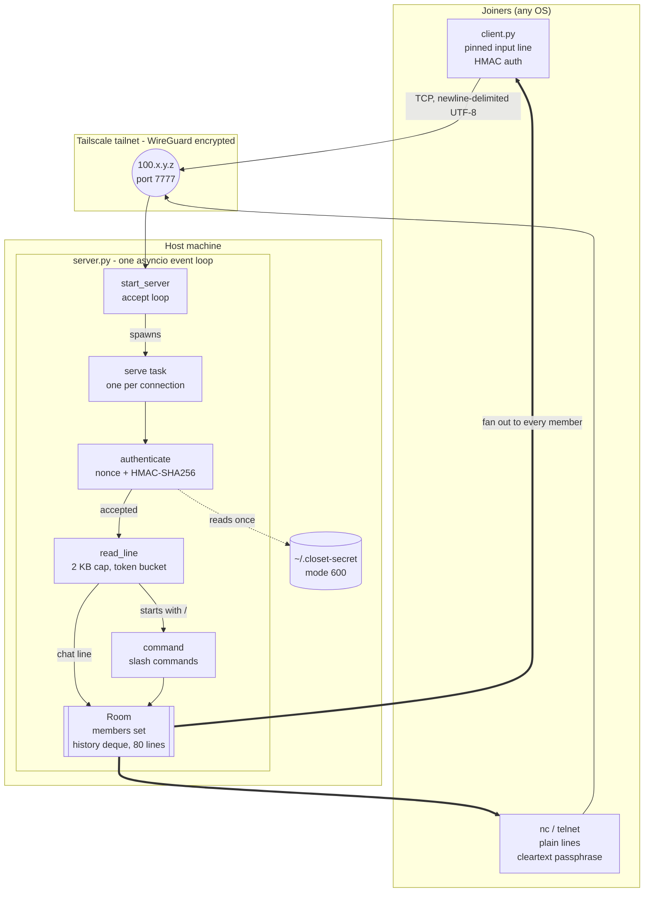
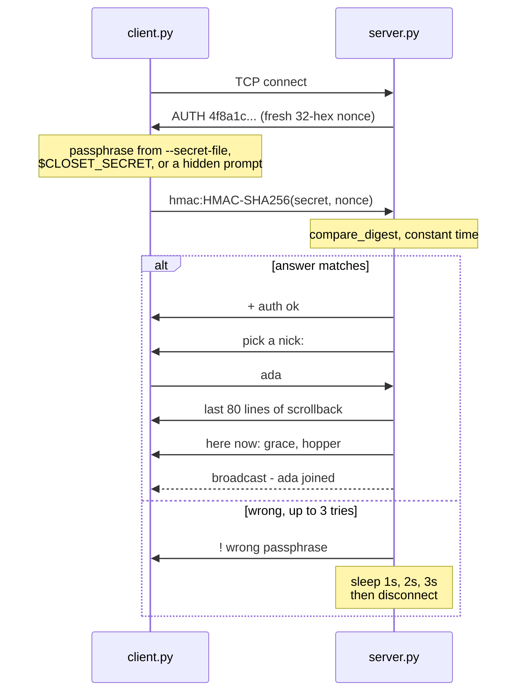

# broom closet

A private terminal chat room you can share with a few friends. One Python file
for the server, one for the client, no dependencies beyond the standard
library.

The wire protocol is newline-delimited UTF-8 over plain TCP, so anyone with
`nc` can join without installing a thing. The client just makes it pleasant:
your input line stays pinned to the bottom while messages scroll above it.

```
== broom closet ==
[21:04] * ada joined
[21:04] <ada> is this thing on
[21:05] <grace> loud and clear
[21:05] * ada waves
> _
```

## How it fits together



There is no database, no worker pool, and no thread per client. One event
loop runs one `serve` task per connection; they all share a single `Room`
object holding the member set and an 80-line history deque. "Broadcast" is
just a loop over that set writing to each transport, which is why the whole
server is one file.

The passphrase is read from disk once at startup. It is never sent to anyone,
in either direction:



A captured reply is useless against the next nonce, so the handshake is not
replayable. The `nc` route skips the HMAC and sends the passphrase as one
plain line, which is why it is only safe inside Tailscale or an SSH tunnel.

## Requirements

- **Python 3.9+.** That is the whole list — no pip packages, standard library
  only.
- **Linux and macOS** get the full client: pinned input line, arrow-key
  history, colored nicks.
- **Windows** has its own installer (see below) and falls back to plain
  line-at-a-time input, because raw terminal input is POSIX-only. WSL gets the
  full experience.
- Any machine with `nc` can join with nothing installed at all.

## Try it locally first

Two terminals on one machine, no setup:

```sh
./server.py          # listens on 127.0.0.1:7777
./client.py          # in another terminal
```

Pick a nick when asked, or skip that with `./client.py --nick ada`. This proves
the code works before you take on any networking.

## Install

Three machines, two scripts. They are idempotent, print every step, and each
has an uninstaller that undoes exactly what it did.

### On the host

```sh
scripts/install-server.sh                 # with Tailscale — reachable anywhere
scripts/install-server.sh --service       # ...and restart on boot
scripts/install-server.sh --no-tailscale  # LAN only; you handle the routing
```

It verifies Python, generates a random passphrase at `~/.closet-secret` (mode
600), installs and enables Tailscale, and configures firewalld. Tailscale login
needs a browser, so the script stops and tells you to run `sudo tailscale up`
yourself, then re-run it to finish. At the end it prints the address and
passphrase your friends need.

### On every machine that joins

Install Tailscale and log into **the same account** as the host, then copy
`client.py` and `scripts/install-client.sh` over and run:

```sh
scripts/install-client.sh --host 100.x.y.z              # prompts for the passphrase
CLOSET_SECRET='...' scripts/install-client.sh --host 100.x.y.z   # unattended
scripts/install-client.sh --host 192.168.1.50 --lan     # same network, no VPN
```

On **Windows**, use the PowerShell installer instead — the bash scripts do
nothing in cmd.exe or PowerShell:

```powershell
powershell -ExecutionPolicy Bypass -File .\scripts\install-client.ps1 -ServerHost 100.x.y.z
```

The `-ExecutionPolicy Bypass` is needed because Windows blocks unsigned
scripts by default; without it the script refuses to run. It needs no admin
rights, installs to `%LOCALAPPDATA%\broom-closet`, locks the passphrase down
with `icacls` so only your account can read it, and puts a `closet` command on
your user PATH. **Open a new terminal** before `closet` is recognized.

Windows does not ship Python, and typing `python` usually just opens the
Microsoft Store. Install the real thing from
<https://www.python.org/downloads/windows/> with **"Add python.exe to PATH"**
ticked, or `winget install --id Python.Python.3.12`. The installer detects
`py -3`, `python`, and `python3`, rejects anything below 3.9, and tells you
what to do if none works.

Undo it with:

```powershell
powershell -ExecutionPolicy Bypass -File .\scripts\uninstall-client.ps1
```

Native Windows gets the simpler client: type a line, press Enter, no pinned
input line or arrow-key history. For the real thing, run `wsl --install` and
use the bash installer inside WSL.

Taildrop is the easiest way to move those two files once Tailscale is up on
both ends:

```sh
tailscale file cp client.py scripts/install-client.sh <device>:
```

The installer puts `client.py` in `~/.local/share/broom-closet/`, the
passphrase in `~/.closet-secret` (mode 600), and a `closet` command in
`~/.local/bin/` with the address and passphrase already filled in. Joining is
then one word:

```sh
closet
closet --nick someoneelse
```

Everything is under `$HOME`. The only exceptions are on the host: an optional
systemd unit and a firewalld rule, both removed by the uninstaller.

## Reaching the server

The server binds to `127.0.0.1` by default, so nothing can reach it until you
choose how to be reachable. That default is deliberate.

### Tailscale — recommended

A WireGuard mesh VPN. Your tailnet becomes the access list: no public port
exists, traffic is encrypted, and "outside my network" stops being a special
case. It also traverses NAT using only outbound connections, which means it
works from inside a NAT'd VM with no host configuration at all.

```sh
sudo tailscale up                 # once, interactive
./server.py --host "$(tailscale ip -4)" --secret-file ~/.closet-secret
```

Friends join your tailnet by invite from the admin console, then run `closet`.
Anyone not on the tailnet cannot connect at all.

If firewalld is running, `tailscale0` must be in the trusted zone or tailnet
traffic gets dropped into `public`. The install script does this; by hand:

```sh
sudo firewall-cmd --zone=trusted --add-interface=tailscale0
sudo firewall-cmd --permanent --zone=trusted --add-interface=tailscale0
```

### LAN only

Bind to your real LAN address and open the port:

```sh
sudo firewall-cmd --add-port=7777/tcp     # add --permanent to survive reboot
./server.py --host 192.168.1.50 --secret-file ~/.closet-secret
```

Clients use `--lan` at install time. This works only for machines on the same
network.

### LAN from inside a VirtualBox NAT guest

A guest on NAT has an address like `10.0.2.15` with gateway `10.0.2.2`. Those
exist only inside VirtualBox and nothing on your network can route to them, so
binding to the LAN is not enough — inbound connections are dropped before they
arrive. Forward a host port into the guest instead.

On the **host** (`controlvm` applies to a running VM; `modifyvm` is the
persistent form and needs the VM powered off):

```sh
VBoxManage list vms
VBoxManage controlvm "<VM NAME>" natpf1 "closet,tcp,,7777,,7777"
```

Fields are `name,proto,hostip,hostport,guestip,guestport`; empty host IP means
all host interfaces. Pin it to one interface to narrow exposure:

```sh
VBoxManage controlvm "<VM NAME>" natpf1 "closet,tcp,192.168.1.50,7777,,7777"
```

In the **guest**, bind to `0.0.0.0` — forwarded connections arrive from the NAT
gateway, not from your LAN, so a more specific bind will not catch them:

```sh
./server.py --host 0.0.0.0 --secret-file ~/.closet-secret
```

Clients then connect to the **host's** LAN IP, not the guest's. Remove the rule
with `VBoxManage controlvm "<VM NAME>" natpf1 delete closet`.

Switching the adapter to **Bridged** also works and gives the guest a real LAN
address, but it exposes every listening port on the guest rather than just one.
Tailscale avoids this whole section.

### A VPS with a reverse tunnel

Keeps the server bound to localhost, never listening publicly, with SSH
providing encryption end to end.

```sh
# on the machine running the server
ssh -N -R 7777:localhost:7777 you@your-vps

# on each friend's machine
ssh -N -L 7777:localhost:7777 you@your-vps
closet          # or: ./client.py 127.0.0.1 7777
```

### Forwarding a port on your router

Don't. It puts a few hundred lines of hand-rolled, unaudited parsing in front
of the entire internet, in plaintext. The passphrase helps; it is not a
substitute for an audit. If you must expose this publicly, terminate TLS in
front of it with `caddy` or `stunnel` and treat the passphrase as a second
layer rather than the only one.

## The passphrase

Without a secret the room is open to anyone who can reach the port, and the
server says exactly that at startup (`auth DISABLED — anyone can join`). To
gate it:

```sh
install -m 600 /dev/null ~/.closet-secret
printf 'some long shared passphrase' > ~/.closet-secret
./server.py --secret-file ~/.closet-secret --host 0.0.0.0
```

Clients supply it three ways:

```sh
./client.py <host> --secret-file ~/.closet-secret
CLOSET_SECRET='some long shared passphrase' ./client.py <host>
./client.py <host>                       # prompts, input hidden
```

The passphrase is never a command-line argument on purpose — argv is visible to
every user on the machine via `ps`.

**How it works.** The server sends a random nonce and expects
`HMAC-SHA256(secret, nonce)` in reply, so the secret never crosses the wire and
a captured answer cannot be replayed against a later nonce. Comparison is
constant-time. Three wrong answers close the connection, each after a growing
delay, and every failure is logged with the peer address.

A client that cannot compute an HMAC may instead send the passphrase itself as
one line, which is what keeps `nc` usable. **That path sends the secret in the
clear**, so use it only over something already encrypted — Tailscale or an SSH
tunnel.

**What it does not do.** It controls who gets in, not what they can read.
Messages are still plaintext on the wire. One shared secret, not accounts, so
locking one person out means rotating the passphrase for everyone.

## In the room

| | |
|---|---|
| `/help` | list commands |
| `/nick <name>` | change your nick |
| `/me <action>` | third-person line |
| `/msg <nick> <text>` | private message |
| `/who` | who is here |
| `/uptime` | how long you have been connected |
| `/quit` | leave (`/part`, `/exit` work too) |

Client keys: left/right to move, up/down through what you have sent, `home`
and `end`, `delete`, `ctrl-u` clear line, `ctrl-w` delete word, `ctrl-a` and
`ctrl-e` jump to the ends, `ctrl-l` clear screen, `ctrl-c` leave.

Arrivals get the last 80 lines replayed, so joining late still gives you the
thread of the conversation.

Nicks are up to 20 characters of letters, digits, and `_-[]{}^|`.

## Running it permanently

`scripts/install-server.sh --service` writes a systemd unit that resolves the
Tailscale address at start time rather than install time, and restarts on
failure.

```sh
systemctl status broom-closet
journalctl -u broom-closet -f
```

## Uninstalling

```sh
scripts/uninstall-server.sh              # keeps Tailscale; other things may use it
scripts/uninstall-server.sh --tailscale  # removes it too
scripts/uninstall-client.sh
```

Destructive steps ask first unless you pass `--yes`. Removing Tailscale also
leaves the machine registered in the admin console — delete it at
<https://login.tailscale.com/admin/machines>.

## Troubleshooting

**Connection refused.** The server is not running, or it is bound somewhere the
client cannot reach. Check what it actually bound to — it logs
`listening on ('x.x.x.x', 7777)` at startup. Binding to `127.0.0.1` is the
default and is not reachable from another machine.

**Connection times out instead of refusing.** Something is dropping packets
silently: a firewall, or NAT with no forwarding rule. Test reachability
directly:

```sh
python3 -c "import socket;socket.create_connection(('<host>',7777),5);print('reachable')"
```

**`closet: command not found`.** `~/.local/bin` is not on your `PATH`. Add
`export PATH="$HOME/.local/bin:$PATH"` to your shell rc, or run
`~/.local/bin/closet` directly.

**`passphrase rejected`.** The client's secret does not match the server's.
Compare them exactly — a trailing newline matters, which is why the scripts use
`printf` rather than `echo`. Delete `~/.closet-secret` and re-run the client
installer to re-enter it.

**An install script exits without explaining itself.** It should not any more
— every script reports the failing line, command, and exit code. For the full
picture, re-run with `--trace`:

```sh
bash scripts/install-server.sh --trace
```

Steps that need `sudo` ask for your password once, up front, before anything
else happens. If `pacman` cannot find `tailscale`, your package database is
stale: run a **full** upgrade with `sudo pacman -Syu` and try again. Never
`pacman -Sy <package>` on Arch — partial upgrades break systems.

**On Windows, the script "is not digitally signed" or exits immediately.**
Windows blocks unsigned scripts. Run it as
`powershell -ExecutionPolicy Bypass -File .\scripts\install-client.ps1 ...`
rather than double-clicking it.

**Garbled display or no pinned input line.** You are in the fallback mode: not a
TTY, or on native Windows. Use WSL on Windows.

**`! line too long, dropped`.** A single line exceeded 2 KB. The client
truncates at 800 characters, so this generally means something other than
`client.py` is sending.

**`! slow down`.** The flood limiter: bursts of 10 messages, then about 2 per
second sustained.

## Files

```
server.py                      the room
client.py                      the terminal client
scripts/install-server.sh      host setup: passphrase, Tailscale, firewall, service
scripts/uninstall-server.sh    undoes the above
scripts/install-client.sh      joiner setup: client.py, passphrase, `closet` command
scripts/uninstall-client.sh    undoes the above
scripts/install-client.ps1     the same, for Windows without WSL
scripts/uninstall-client.ps1   undoes the above
```

Server options: `--host`, `--port`, `--motd`, `--secret-file`.
Client options: `[host] [port]`, `--nick`, `--secret-file`.

## What is deliberately missing

- **No encryption.** Bind to Tailscale, which encrypts for you, or put TLS in
  front. The passphrase controls entry, not confidentiality.
- **No accounts.** One shared passphrase, and nicks are first-come,
  first-served, so nothing stops a friend from taking a free one.
- **No persistence.** Scrollback lives in memory; a restart empties the room.
- **No federation, no channels.** One closet. That is the whole idea.

Hardening that is present: a token-bucket flood limiter (bursts of 10, then
~2/s), a 2 KB line cap that is drained rather than buffered, a 1 MB cap on a
sender who never sends a newline, a 60-second auth timeout, and constant-time
secret comparison.

This is a weekend project, not audited software. Keep it on a private network.
